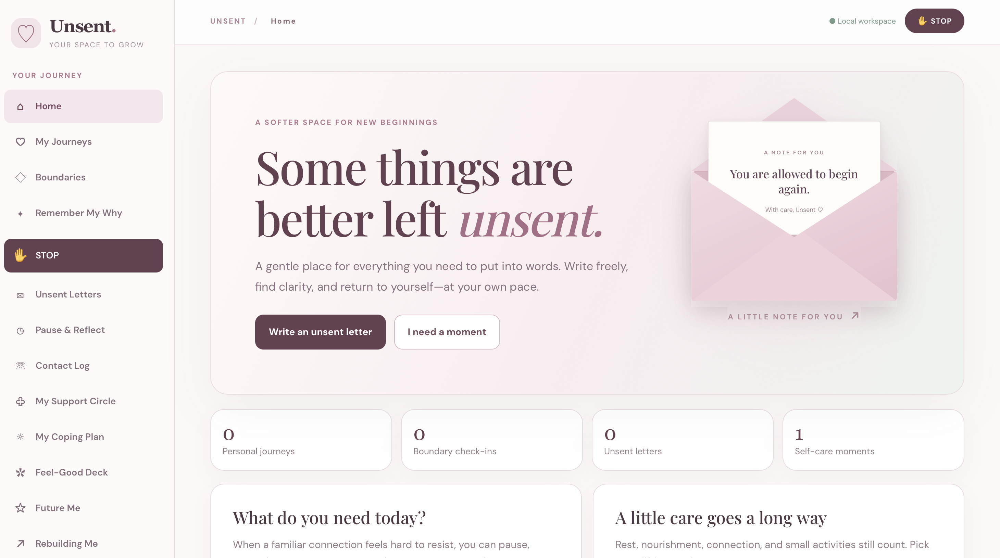
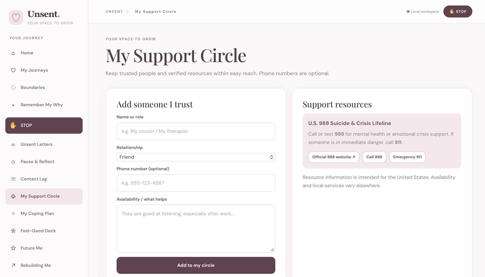
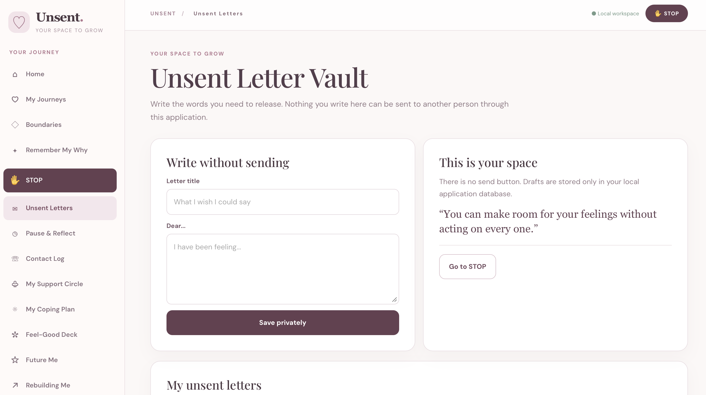

# Unsent. 
**Remember your why & focus on your healing.**

## Application Screenshots

### Homepage


### My Support Circle Page


### My Unsent Letter's Page



A local-first full-stack **Java Spring Boot** project for personal boundaries, relationship transitions, emotional reflection, supportive habits, and rebuilding everyday life. Built for friendships, romantic relationships, family dynamics, and other connections.

> **Important:** Unsent is an educational portfolio project, **not** a crisis hotline, therapist, medical service, or live counseling platform. It does not contact other people or monitor their accounts. The website runs locally and currently has **no user authentication**; do **not** expose the server to the public internet or use this prototype for highly sensitive information on a shared computer. If you need an actual multi-user deployment, add authentication, authorization, encryption/secure secrets management, threat modeling, and privacy/legal review first.

## Run in IntelliJ IDEA (macOS / Windows / Linux)
1. Install **JDK 21 or later** and open the extracted `Unsent` folder in IntelliJ IDEA (File → Open).
2. IntelliJ will detect `pom.xml`. Select **Load Maven Project** / **Sync**. Internet access may be needed the first time to download Spring Boot dependencies.
3. Find `src/main/java/com/unsent/UnsentApplication.java` and click the green triangle to **Run**.
4. Wait for `Started UnsentApplication` and `Tomcat started on port 8083`.
5. Open **http://localhost:8083** in Safari, Chrome, or another browser.
6. Keep IntelliJ's Run session running while using the app.

To change ports, edit `src/main/resources/application.properties`: `server.port=8084` (or any available port), save, restart, then visit the matching localhost URL.

## Features
- **Home:** Welcoming overview and direct support actions
- **My Journeys:** Multiple relationship contexts and no/low/limited contact preferences
- **Boundaries:** Relationship-specific practical communication rules
- **Remember My Why:** Personal reasons and reminders
- **STOP:** Animated hand and STOP headline, inclusive copy, links to reasons, support, and self-care; honors reduced-motion settings
- **Unsent Letters:** Private unsent drafts (no sending mechanism)
- **Pause & Reflect:** Voluntary 10-minute timer and saved triggers/urges
- **Contact Log:** Record practical vs optional interactions without automatic penalties
- **My Support Circle:** Trusted contacts with optional phone numbers; links to official U.S. 988 and emergency 911 services
- **My Coping Plan:** If–then planning for difficult moments
- **Feel-Good Deck:** Preset cards, custom activities, daily completed activities and reflective notes
- **Future Me:** Date-specific private letters; future letters are only visually hidden in the interface (not cryptographically sealed)
- **Rebuilding Me:** Individual aspirations, hobbies, routines, and next steps
- **Milestones:** Daily check-ins per journey, calculated streaks, reduced-motion-friendly confetti
- **Emotional Insights:** Descriptive trends from self-reported entries; never mental-health diagnosis or causality claims

## Technical stack
Java 21, Spring Boot 3.4.4, Spring Web, Spring Data JPA / Hibernate, H2 file database, HTML, CSS, vanilla JavaScript, JUnit 5 and GitHub Actions. No external frontend frameworks or API keys required. Google Fonts load only when connected, with system fallback fonts when offline. No analytics or tracking SDK is included.

## Architecture
```
src/main/java/com/unsent/
  UnsentApplication.java          # Run this class in IntelliJ
  api/UnsentController.java       # REST API endpoints
  model/JournalItem.java          # Typed record kind + JSON details
  model/DailyCheckin.java         # Unique daily journey check-ins
  repo/JournalRepository.java
  repo/CheckinRepository.java
src/main/resources/
  application.properties          # Port 8083, database settings
  static/index.html               # Browser shell
  static/styles.css               # Responsive blush/ivory interface
  static/app.js                   # UI behavior / REST fetch / confetti
src/test/java/com/unsent/         # Spring Boot tests
.github/workflows/ci.yml          # GitHub Actions build
```

## Data & privacy
The H2 database uses `jdbc:h2:file:./data/unsent` **relative to the working directory** (usually the IntelliJ project root). It persists between normal app restarts. Do not delete the `data/` folder when updating source files. Back up this folder safely before changing databases or moving computers. `.gitignore` excludes `data/`, `target/`, IDE files, and secrets. **Do not commit personal entries or contacts to GitHub.**

This is a **single-user local prototype**. It assumes anyone who can access the local web server can access data. It binds to `127.0.0.1` by default to avoid accidental external network exposure. No sign-in, per-user authorization, encryption-at-rest, automatic backups, or secure deletion is implemented. Future date letters are display-gated, not inaccessible to someone with local DB access. Phone numbers are not validated by jurisdiction, and clicking `tel:` is handled by the device; messages are never automatically sent.

### Understanding progress
- **Check-ins:** One per date per relationship journey. Clicking again updates that day's saved check-in.
- **Streak:** Consecutive days with self-reported boundary-honoring check-ins, counted from today (or yesterday if today is not yet logged).
- **Necessary contact:** Not automatically considered a breach. Users select what boundaries mean in context.
- **Self-care:** Logs activities that users explicitly chose, not an objective wellness or mental-health score.
- **Analytics:** Counts and self-reported trigger frequencies, not scientific or clinical inferences.

## API overview
```
GET    /api/health
GET    /api/items?kind=journey&journeyId=1
GET    /api/items/{id}
POST   /api/items
PUT    /api/items/{id}
DELETE /api/items/{id}
GET    /api/checkins?journeyId=1
POST   /api/checkins
DELETE /api/checkins/{id}
GET    /api/future/ready
GET    /api/stats?journeyId=1
```
`/api/items` stores a typed `kind`, a title, text body, optional journey/date, and an optional JSON `details` string. It is intentionally lightweight for an educational MVP, not a final data model for an enterprise deployment.

## Build and test
Use IntelliJ Maven tool window, or `mvn test` / `mvn package` when Maven is installed. CI runs `mvn --batch-mode verify` on JDK 21. Manual smoke test: create a journey, save a reason, add a trusted contact without a number, mark a feel-good card, check in twice on the same date, restart the app, verify that all records persist and the check-in does not duplicate. Also test the STOP page with `prefers-reduced-motion: reduce` enabled.

## Safety
U.S. **988 Suicide & Crisis Lifeline**: [988lifeline.org](https://988lifeline.org/) or call/text **988**. For immediate danger, call **911** in the United States. Unsent offers links to support services, but never offers live crisis intervention or falsely implies a support person is available.

## License
MIT — see `LICENSE`.


## v1.1 interface refinements

- **Homepage:** Softly floating, glowing SVG heart illustration with subtle orbit accents. Motion automatically turns off when the user's system requests reduced motion.
- **My Coping Plan:** Eight clickable coping ideas now populate the trigger, action, and category in the existing If–Then form. Users can customize before selecting **Save coping strategy**; clicking an idea does **not** save it automatically. A selected state and status message confirm the selection.
- The Java API, H2 persistence, other application pages, and initial port **8083** remain unchanged.

If replacing a previous Unsent project folder, preserve the old `data/` directory so you do not lose locally recorded entries.


## Editorial homepage refinement

The homepage includes an interactive envelope that opens to reveal a note of encouragement. It preserves the existing rose, plum, ivory, and sage color palette, while improving typography, responsive spacing, and accessibility (keyboard-operable button and reduced-motion support). The letter is a decorative encouragement interaction; actual letter writing remains in **Unsent Letters**.

**Privacy note:** The current local H2-backed application does not implement a passcode, user login, or at-rest encryption for letters. Do not treat the letter vault as access-controlled. A future lock feature requires server-side authentication and authorization, not merely a frontend lock icon.
